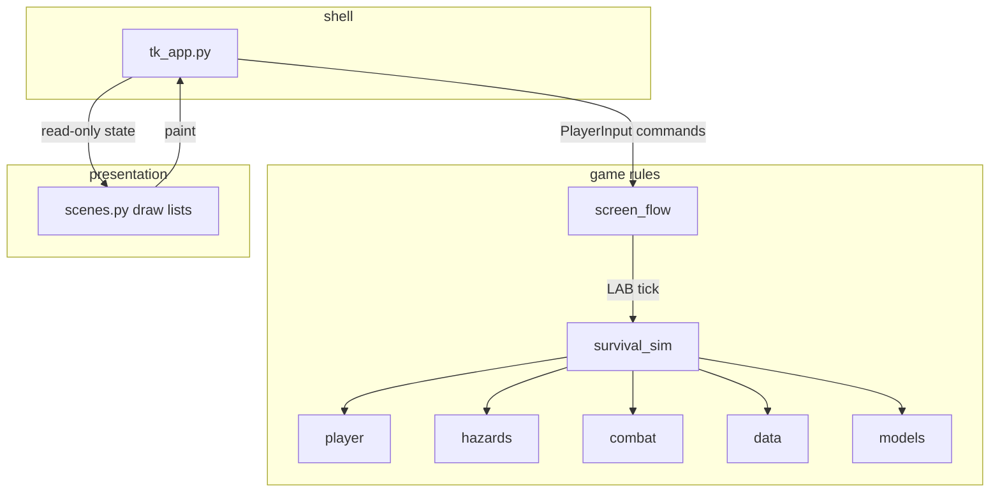

# Periodic Wall v0 — Engineering Plan

## Goal

Implement **Version 0** exactly as specified in [DESIGN.md](clint_games/periodic_wall/DESIGN.md): one level (period 1), dodge-only lab, 5 hearts, 5-minute timer, no fusion/giant ball/lava/nuke. Use **test-driven development**: each box gets tests from DESIGN §12 before (or alongside) implementation.

Keep the old game runnable for comparison by moving it to a **reference folder**, not deleting it.

---

## Target layout (after Phase 0)

```text
periodic_wall/
  DESIGN.md                 # spec (unchanged authority)
  README.md                 # v0: run tests + play
  main.py                   # entry: python3 main.py
  reference/
    README.md               # what this folder is, how to run legacy game
    periodic.py             # moved from root (~2479 lines)
    index.html              # legacy GitHub-pages blurb (optional move)
  game/
    __init__.py
    data.py
    models.py
    player.py
    hazards.py
    combat.py
    survival_sim.py
    screen_flow.py
  presentation/
    __init__.py
    scenes.py               # draw lists + optional Tk paint helpers
  shell/
    __init__.py
    tk_app.py
  tests/
    test_*.py               # one file per box + integration
```

Update cross-links when `main.py` exists:
- [periodic_wall/README.md](clint_games/periodic_wall/README.md) — `python3 main.py`, `pytest`
- [clint_games/README.md](clint_games/README.md) and [periodic_wall/index.html](clint_games/periodic_wall/index.html) — point to v0 run command; link “full legacy game” → `reference/`

---

## Architecture (v0)



**Data flow per frame (lab):** `shell` reads keys → builds `PlayerInput` → `survival_sim.tick(state, input, dt)` → new `GameState` + `events` → `screen_flow` handles `WON`/`DIED` → `presentation` builds draw list → `shell` renders.

---

## Phase 0 — Archive legacy + scaffold (no gameplay yet)

### 0a. Reference archive

| Action | Detail |
|--------|--------|
| Create `reference/` | Add [reference/README.md](clint_games/periodic_wall/reference/README.md): “Legacy monolith (fusion, 7 floors, lava, nuke). Not the v0 spec. Run: `python3 periodic.py` from this folder.” |
| Move files | `periodic.py` → `reference/periodic.py`. Move [index.html](clint_games/periodic_wall/index.html) → `reference/index.html` **or** leave a thin root `index.html` for GitHub Pages that describes v0 + links to reference. |
| Preserve history | No git tricks required; plain move is enough. |

**Extract from reference (read-only, do not import reference at runtime):**
- Period-1 pool: `PERIOD_HAZARDS[0]` + `SYMBOL_Z` entries for H, He, D, T
- Row-1 tuning: first `RowTuning` in reference (`rain_density=0.10`, etc.)
- Physics: `GRAVITY_PX_S2`, `JUMP_VELOCITY`, `JUMP_VELOCITY_AIR`, `FAST_FALL_BOOST`, `HIT_INVULN_S`, `SURVIVE_SECONDS`, `PLAYER_MAX_HP`
- Art reference: `draw_wall_scene`, `_draw_stickman` logic (copy simplified into `presentation/scenes.py`)

### 0b. Project scaffold

- Add `game/`, `presentation/`, `shell/`, `tests/` packages with `__init__.py`
- Add `main.py` that will eventually call `shell.tk_app.run()`
- Add test runner config: `pytest` (stdlib `unittest` acceptable but pytest matches DESIGN tables better)
- Add minimal `requirements-dev.txt` or document `pip install pytest` in README
- Stub `main.py` / empty modules so `pytest` collects zero tests initially, then grow

**Deliverable:** `cd reference && python3 periodic.py` still runs old game; root has clean package tree, no v0 gameplay yet.

---

## Phase 1 — `data` + `models` (DESIGN §12: D-*, M-*)

### `game/data.py`

- `MAX_LEVEL = 1`, period-1 element pool, Z map, gentle spawn constants, room defaults
- Explicitly **no** fusion/lava/nuke constants

### `game/models.py`

- Dataclasses/enums: `Screen` (TITLE, LAB, END), `GameEvent` (HIT, DIED, WON), `PlayerState`, `Ball`, `GameState`, `PlayerInput`
- `GameState.new_lab(rng_seed, room_w, room_h)` factory per M-01
- No `giant_ball`, `shockwaves`, `lava` fields (M-05)

### Tests

- [tests/test_data.py](clint_games/periodic_wall/tests/test_data.py) — scenarios D-01 … D-06
- [tests/test_models.py](clint_games/periodic_wall/tests/test_models.py) — scenarios M-01 … M-05

**Gate:** `pytest tests/test_data.py tests/test_models.py` green.

---

## Phase 2 — `player` (P-*)

### `game/player.py`

Pure functions, no Tk:

- `step_player(state, input, dt, floor_y, room_w)` → updated position, vy, ducking, hitbox `(cx, cy, r)`
- Wall clamps, gravity, ground land, air jump (match reference behavior per P-05)
- Duck shrinks hitbox (P-07, P-10)

### Tests

- [tests/test_player.py](clint_games/periodic_wall/tests/test_player.py) — P-01 … P-10 with fixed `dt` (e.g. 1/60)

**Gate:** player tests green; still no hazards.

---

## Phase 3 — `hazards` (H-*)

### `game/hazards.py`

- Injectable `random.Random(seed)` for determinism (H-02)
- `spawn_tick(state, dt, rng)` — period-1 symbols only, respect cap (H-06)
- `integrate_balls(balls, dt, room_w, room_h)` — fall, cull off-screen (H-04, H-05)
- **No fusion:** overlapping balls unchanged (H-07)

### Tests

- [tests/test_hazards.py](clint_games/periodic_wall/tests/test_hazards.py) — H-01 … H-09

**Gate:** hazards tests green.

---

## Phase 4 — `combat` (C-*)

### `game/combat.py`

- `apply_damage(hearts, invuln_until, amount, now)` → new hearts, invuln, `is_dead`
- Ball–player overlap helper using hitbox + ball radius

### Tests

- [tests/test_combat.py](clint_games/periodic_wall/tests/test_combat.py) — C-01 … C-06

**Gate:** combat tests green.

---

## Phase 5 — `survival_sim` (S-*, I-partial)

### `game/survival_sim.py`

Single public API:

```python
def tick(state: GameState, input: PlayerInput, dt: float, rng: random.Random) -> tuple[GameState, list[GameEvent]]:
```

Order inside tick (DESIGN §5 / layer stack):

1. Decrement `time_left`; if `<= 0` and hearts > 0 → `WON`
2. If hearts == 0 → `DIED` (already dead)
3. `hazards.spawn` + `integrate`
4. `player.step`
5. Collision: combat overlap → remove ball, damage, `HIT` event
6. Return new state + events

**Explicitly omit:** `_resolve_hazard_fusions`, giant ball, shockwaves, lava tick.

### Tests

- [tests/test_survival_sim.py](clint_games/periodic_wall/tests/test_survival_sim.py) — S-01 … S-10
- Start [tests/test_v0_playthrough.py](clint_games/periodic_wall/tests/test_v0_playthrough.py) with I-01, I-02, I-05 (fast sim loops, no GUI)

**Gate:** survival + core integration tests green.

---

## Phase 6 — `screen_flow` (F-*)

### `game/screen_flow.py`

- Command enum: `PLAY`, `PLAY_AGAIN`, `QUIT`, `FORFEIT`, etc.
- `reduce(screen, command, events) -> (screen, GameState | None)` 
- Reject `PICK_LEVEL_2`, `START_NUKE` (F-07, F-08)
- Fresh lab state on `PLAY` / `PLAY_AGAIN` (F-02, F-06)

### Tests

- [tests/test_screen_flow.py](clint_games/periodic_wall/tests/test_screen_flow.py) — F-01 … F-08

**Gate:** screen_flow tests green.

---

## Phase 7 — `presentation` (R-*)

### `presentation/scenes.py`

- **Draw-list first** (testable): `build_title_draw_list(w, h)`, `build_lab_draw_list(state)`, `build_end_draw_list(won: bool)`
- Primitives: `Rect`, `Circle`, `Text`, `Line` (dataclasses or typed dicts)
- Port simplified art from reference `draw_wall_scene` / stickman (no fusion visuals)
- Optional: `paint_to_canvas(canvas, draw_list)` for shell only

### Tests

- [tests/test_presentation.py](clint_games/periodic_wall/tests/test_presentation.py) — R-01 … R-08 (assert on draw list contents, not pixels)

**Gate:** presentation tests green.

---

## Phase 8 — `shell` + wire-up (K-*, layers 0–7)

### `shell/tk_app.py`

Implement DESIGN layers in order:

| Layer | Shell behavior |
|-------|----------------|
| 0 | Window, title screen, Play → lab, Quit |
| 1 | Empty lab render (floor + stickman) |
| 2–6 | Hook `survival_sim.tick` on timer (~33 ms), key bindings → `PlayerInput` |
| 7 | End banner / labels; Play again → new lab |

- **No** floor 1–7 bar; single **Play** → lab (DESIGN §4)
- Use `place` + `tkraise` or simple single-frame layout (avoid reference `pack_forget` ghost-click issues)
- `bind_all` for keys during lab

### `main.py`

```python
from shell.tk_app import run
if __name__ == "__main__":
    run()
```

### Tests

- [tests/test_shell_smoke.py](clint_games/periodic_wall/tests/test_shell_smoke.py) — K-01 … K-03 (minimal; mark `@pytest.mark.gui` optional skip in CI)
- Complete [tests/test_v0_playthrough.py](clint_games/periodic_wall/tests/test_v0_playthrough.py) — I-03, I-04

**Gate:** `python3 main.py` playable; `pytest` (excluding optional GUI) green.

---

## Phase 9 — Docs and repo hygiene

- Rewrite [README.md](clint_games/periodic_wall/README.md): v0 commands, test command, link to `reference/` for legacy
- Update [DESIGN.md](clint_games/periodic_wall/DESIGN.md) §17 folder tree to show `reference/` (small doc sync, optional)
- Update [clint_games/index.html](clint_games/index.html) card text if run instructions change
- Consider shortening I-01 test: simulate 300s at coarse `dt` (e.g. 1.0s steps) for speed in CI

---

## What we deliberately do not port from reference

| Reference feature | v0 action |
|-------------------|-----------|
| Fusion / shockwaves / giant ball | Omit entirely |
| Floors 2–7, nuke screen | Omit |
| Lava, platforms, scrolling | Omit |
| `draw_building_scene`, play bar 1–7 | Omit; use simple Play → lab |

---

## Suggested implementation order (sprints)

| Sprint | Phases | Outcome |
|--------|--------|---------|
| 1 | 0 | Reference archived; package skeleton; pytest runs |
| 2 | 1–2 | Data, models, player + tests |
| 3 | 3–4 | Hazards, combat + tests |
| 4 | 5–6 | survival_sim, screen_flow + tests |
| 5 | 7–8 | presentation, shell, main.py playable |
| 6 | 9 | README, integration polish, CI-friendly test times |

---

## Success criteria

- [ ] Legacy game runs from `reference/periodic.py`
- [ ] v0 runs from `python3 main.py` at repo root
- [ ] All DESIGN §12 scenario IDs covered by named tests
- [ ] No fusion/giant_ball in `GameState` or draw lists (I-05)
- [ ] `pytest` passes without opening a window (except optional smoke marks)
